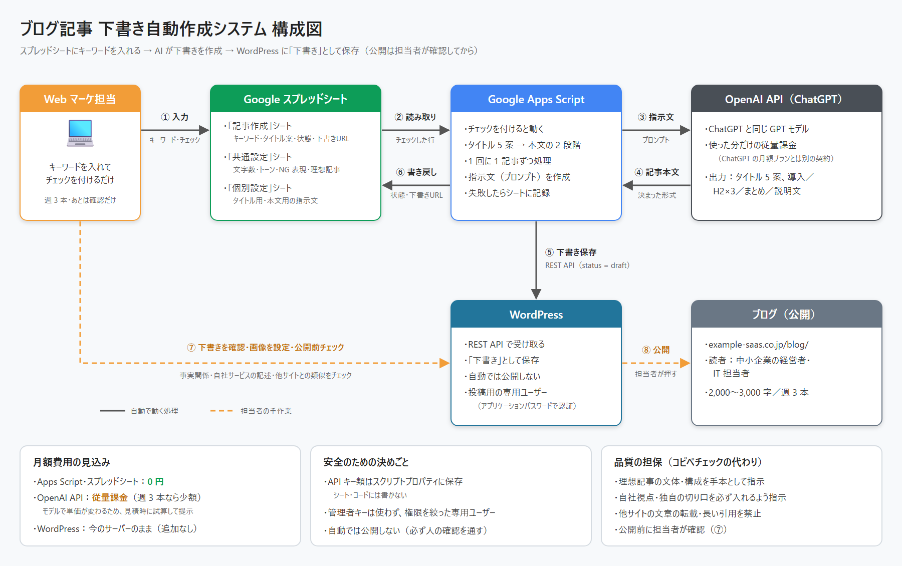
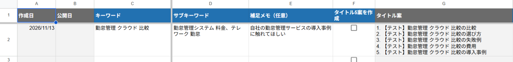
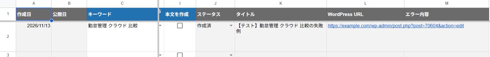

# ブログ記事 下書き自動作成（Google スプレッドシート × OpenAI × WordPress）

スプレッドシートにキーワードを入れてチェックを付けると、AI がタイトル案と記事の下書きを作り、WordPress に **「下書き」として保存** する仕組みです。

> **疑似案件です。** 「SEO 記事を週 3 本、1 本 3 時間かけて書いている会社」を想定し、提案書・見積もり（WBS）・要件定義から開発・テストまでを一通り制作しました。実在のお客様・WordPress サイトはありません。WordPress への送信は、手元に置いた仮の WordPress で確認しています。



| タイトル 5 案（テスト用の設定で実行） | 下書き保存後（作成済・タイトル・WordPress の URL） |
|---|---|
|  |  |

## できること

- キーワード（＋サブキーワード・補足メモ）から、記事タイトルを 5 案作る
- 選んだタイトルで記事を作る（導入 → 見出し 3 つ → まとめ、2,000〜3,000 字、説明文つき）
- WordPress REST API で **下書き** として保存し、シートに状態・タイトル・下書きの URL・作成日を書く
- 文字数・トーン・使わない表現・理想記事（手本）・AI への指示文を、シートから変えられる（「反映する」にチェックを付けると次の作成から使われる）
- 失敗したときは、理由を日本語でシートに書く（API キー違い・WordPress のパスワード違い・権限不足・URL 違いなど）

自動では公開しません。AI の誤りがそのまま公開されないよう、公開は必ず人が行います。

## 使い方（担当者）

| シート | すること |
|---|---|
| 記事作成 | キーワードを入れる →「タイトル5案を作成」にチェック → 番号を選ぶ →「本文を作成」にチェック → 下書きを確認して公開 →「公開済」にする |
| 共通設定 | 文字数・読者・トーン・使わない表現・理想記事を書き換えて「反映する」 |
| 個別設定 | タイトル用・本文用の AI への指示文を書き換えて「反映する」 |

## 構成

| 使うもの | 役割 |
|---|---|
| Google スプレッドシート | 入力と管理の画面 |
| Google Apps Script（V8） | チェックボックスで動く処理の本体（インストール型の編集トリガー） |
| OpenAI API（Chat Completions・JSON スキーマ指定） | タイトル案と記事の作成 |
| WordPress REST API（`POST /wp-json/wp/v2/posts`） | 下書きの保存。寄稿者権限（下書きのみ作れる）の専用ユーザーとアプリケーションパスワード（Basic 認証）で接続 |

API キーとパスワードはスクリプトプロパティに保存し、コードとシートには書きません。

## ファイル

```
gas/                    Apps Script のコード
  Config.js             シート名・列・定数
  Code.js               チェックボックスが押されたときの受け口（同時に押されても 1 件ずつ処理）
  Settings.js           共通設定・個別設定の読み込みと「反映」
  OpenAi.js             OpenAI API の呼び出し
  Titles.js             タイトル 5 案の作成
  Body.js               本文の作成と HTML への変換
  WordPress.js          WordPress への下書き保存
  TestOutput.js         作った記事本文と説明文を、確認用に別のスプレッドシートへ書き出す
  Setup.js              シートの作成（初回だけ実行）
test/
  mock-wordpress.js     仮の WordPress（REST API の投稿作成だけをまねる）
  send-draft-test.js    WordPress への送信テスト
docs/setup.md           セットアップ手順
docs/test-report.md     テスト報告書（仕組みのテストと、記事 5 本の品質テスト）
docs/client/            お客様向けの納品資料（index.html から開く）
  api-setup.html        ① API キー設定手順書
  manual.html           ② 使い方マニュアル（画面写真つき）
  troubleshooting.html  ③ トラブルシューティング
proposal.md             提案書
requirements.md         要件定義書
wbs.md                  見積もり（WBS）
architecture.md         技術構成
```

## WordPress が無い状態での確認方法

Apps Script は Google のサーバーで動くため、手元の PC の WordPress には届きません。そこで 2 つに分けて確認しています。

1. **送信の中身**: `gas/WordPress.js` と同じ関数で作ったリクエストを、Node.js から仮の WordPress に実際に送る

   ```
   node test/send-draft-test.js
   ```

   ```
   ✔ 正しい設定（201）
   ✔ パスワード違い（401）
   ✔ 権限の無いユーザー（403）
   ✔ URL 違い（404）
   ✔ セキュリティプラグインが止めた（403）
   ✔ サーバーのエラー（500）
   仮の WordPress に保存された下書き: 1 本
     ✔ status が draft（公開されない）
     ✔ タイトルが届いている
     ✔ 見出し（h2）が 4 つ（3 つ + まとめ）
     ✔ 説明文（excerpt）が届いている
     ✔ 専用ユーザーで送っている
   ```

2. **シートの動き**: スクリプトプロパティ `OPENAI_MOCK` と `WP_MOCK` を `true` にすると、OpenAI と WordPress を呼ばずにテスト用の結果を返すので、API キーや WordPress が無くてもシート上の流れを最後まで確かめられる

本物の WordPress での確認（専用ユーザーで下書きを 1 本保存する）は、納品先のサイトがあるときに着手前に行う想定です。

## テストの結果

仕組みのテストに加え、本物の AI で記事を 5 本作って品質を確かめました。安いモデル（gpt-4.1-mini）では字数不足や理想記事との重複が直らず、gpt-6.1-sol に変えると要件（2,000〜3,000 字・トーン・独自性・説明文 120 字以内）を満たしました。詳しくは [docs/test-report.md](docs/test-report.md) を参照してください。

## セットアップ

[docs/setup.md](docs/setup.md) を参照してください。
