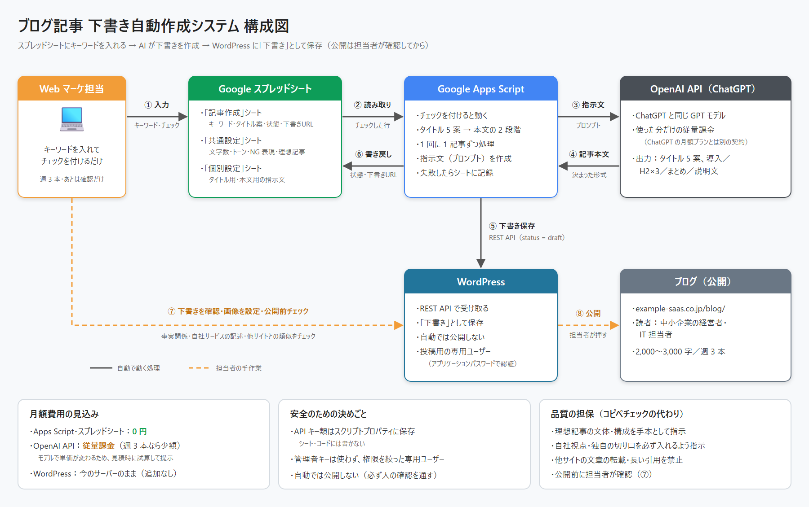

# ブログ記事 下書き自動作成システム — 技術構成

## 1. 構成要素

| 要素 | 使うもの | 役割 | 費用 |
|---|---|---|---|
| 入力・管理画面 | Google スプレッドシート | キーワードを入れ、チェックボックスで作成を始める場所。記事の状態（未作成→タイトル案あり→作成済→公開済）と下書き URL を一覧で見られる | 0 円 |
| 処理の本体 | Google Apps Script | シートを読み、AI に指示を出し、WordPress に下書きを保存する。シートのチェックボックスにチェックを付けると動く | 0 円 |
| 文章生成 | OpenAI API（ChatGPT と同じ GPT モデル） | 指示文（プロンプト）をもとに、タイトル 5 案と、導入／H2×3／まとめ／説明文（メタディスクリプション）を作る | 従量課金（gpt-6.1-sol で 1 本 約 7 円・月 約 100 円の試算） |
| 投稿先 | WordPress REST API | 受け取った記事を **「下書き」** として保存する。自動では公開しない | 0 円（今のサーバーのまま） |
| 秘密情報の保管 | スクリプトプロパティ | OpenAI の API キー、WordPress のユーザー名とアプリケーションパスワード | 0 円 |

## 2. 処理の流れ

| # | だれ／どこが | 何をする | 自動／手作業 |
|---|---|---|---|
| ① | マーケ担当 | 「記事作成」シートにキーワード（必要ならサブキーワード・補足メモ）を入れ、「タイトル5案を作成」にチェックを付ける | 手作業 |
| ② | Apps Script → OpenAI | 「共通設定」「個別設定」の内容を組み込んだ指示文を送り、タイトル 5 案を受け取ってシートに書く | 自動 |
| ③ | マーケ担当 | 使うタイトルの番号を選び、「本文を作成」にチェックを付ける | 手作業 |
| ④ | Apps Script → OpenAI | 記事を決まった形式（導入・見出し 3 つ・まとめ・説明文に分けたデータ）で受け取る | 自動 |
| ⑤ | Apps Script → WordPress | REST API で下書きとして保存（`status = draft`） | 自動 |
| ⑥ | Apps Script → シート | 状態を「作成済」にし、タイトル・下書き URL・作成日を書き込む。失敗したらエラー内容を書く | 自動 |
| ⑦ | マーケ担当 | WordPress で下書きを読み、画像を設定し、公開前チェックをする | 手作業 |
| ⑧ | マーケ担当 | 公開ボタンを押し、シートの状態を「公開済」にする（公開日が自動で入る） | 手作業 |

## 3. スプレッドシートの設計

**「記事作成」シート**

| 列 | 入れる人 | 内容 |
|---|---|---|
| 作成日 | 自動 | 「本文を作成」で下書きを保存した日 |
| 公開日 | 自動 | 状態を「公開済」にした日 |
| キーワード | マーケ担当 | 例: `勤怠管理 クラウド 比較` |
| サブキーワード | マーケ担当 | 一緒に入れたい言葉 |
| 補足メモ（任意） | マーケ担当 | 入れてほしい自社サービスの話、想定読者の悩みなど |
| タイトル5案を作成 | マーケ担当 | チェックを付けるとタイトル案を作る |
| タイトル案 | 自動 | 5 案 |
| 採用する案（1〜5） | マーケ担当 | 使うタイトルの番号 |
| 本文を作成 | マーケ担当 | チェックを付けると本文を作り、WordPress に下書き保存する |
| ステータス | 自動（公開済だけ手で） | 未作成／タイトル案あり／作成中／作成済／エラー／公開済 |
| タイトル | 自動 | 下書きにしたタイトル |
| WordPress URL | 自動 | WordPress の編集画面へのリンク |
| エラー内容 | 自動 | 失敗したときだけ（説明文が 120 字を超えたときは注意を書く） |
| 説明文（120 字以内） | 自動 | 検索結果に表示される説明文（メタディスクリプション）。WordPress の「抜粋」にも入れる |

**「共通設定」シート**（コードを触らずに書き方を調整できる。「反映する」にチェックを付けると次の作成から使われる）

| 項目 | 初期値 |
|---|---|
| 文字数 | 2,000〜3,000 字 |
| 構成 | タイトル → 導入 → 見出し（H2）3 つ → まとめ |
| 読者 | 中小企業の労務・総務の担当者（経営者が読んでも分かるように） |
| トーン | カジュアルだけど専門的 |
| 使わない表現 | 断定しすぎる表現、他社名の批判、根拠のない数字 |
| 独自性のルール | 自社の視点・独自の切り口・具体例を入れる。他サイトの文章を写さない |
| 理想記事（手本） | 理想記事の本文を貼り付ける |

**「個別設定」シート**: タイトル生成・本文生成それぞれの指示文。`{キーワード}` などの差し込みが使える。「反映する」にチェックを付けると次の作成から使われる

## 4. 安全面の決めごと

| 項目 | 方針 | 理由 |
|---|---|---|
| WordPress の権限 | 管理者キーは使わず、**投稿用の専用ユーザー**（寄稿者の権限。下書きは作れるが公開はできない）を作り、アプリケーションパスワードで接続 | 鍵が漏れても、サイト設定やユーザーを書き換えられないようにする |
| 公開 | 自動では公開しない（下書きまで） | AI の誤り・不適切な表現をそのまま世に出さない |
| API キー類 | スクリプトプロパティに保存。シート・コードには書かない | シートを共有しても鍵が見えないようにする |
| 二重投稿 | 処理を始めた行は「作成中」にしてから進める | 同じキーワードで 2 本作られるのを防ぐ |

## 5. 品質の担保（コピペチェックの代わり）

| 対策 | 内容 |
|---|---|
| 指示文で独自性を出す | 自社視点・独自の切り口・具体例を必ず入れるよう指示。他サイトの文章の転載・長い引用を禁止 |
| 理想記事を手本にする | いただいた記事の文体・構成を指示文に反映 |
| 公開前の人の確認（⑦） | 事実関係・自社サービスの記述・他サイトとの類似を担当者がチェック（必要なら市販の類似チェックツールを手作業で利用） |

## 6. 想定される注意点

| 注意点 | 対応 |
|---|---|
| ChatGPT の月額プランでは API は使えない | OpenAI API の利用登録（従量課金・前払い最低 5 ドル）が別途必要。1 本 約 7 円・月 約 100 円の試算 |
| 安いモデルは長い指示を守りきれない | テストで gpt-4.1-mini は字数が半分ほどで、繰り返しやタイトルとのずれが残った。gpt-6.1-sol では字数・構成とも指示どおりだったため、こちらを使う |
| Apps Script の実行時間・通信時間に上限がある | 1 回の実行で 1 記事ずつ処理する。同時にチェックされても順番に処理する |
| サーバーやセキュリティプラグインが REST API の認証をブロックすることがある | 着手前に、専用ユーザーで下書きを 1 本保存するテストを行う |
| AI の文章に事実誤りが混じる可能性 | 下書き止まり＋公開前の確認でカバー（⑦） |
