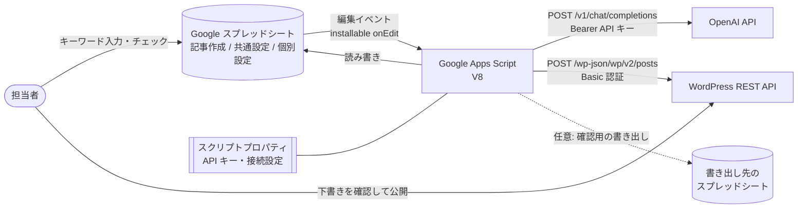
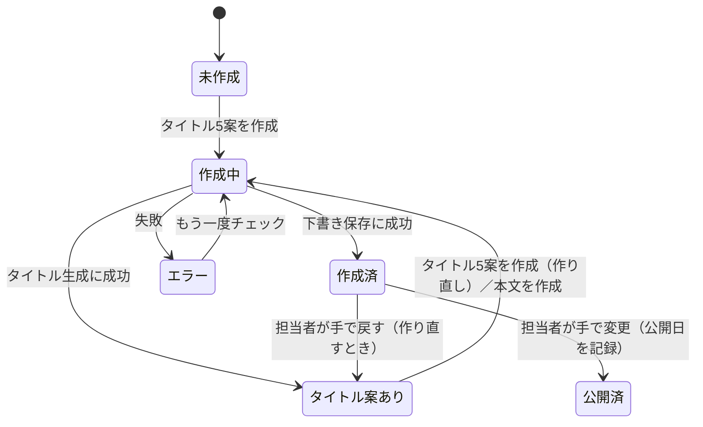
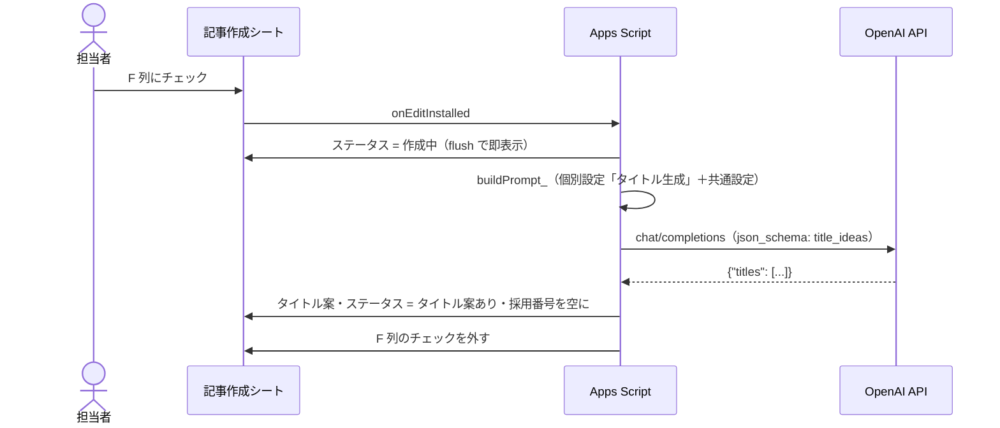
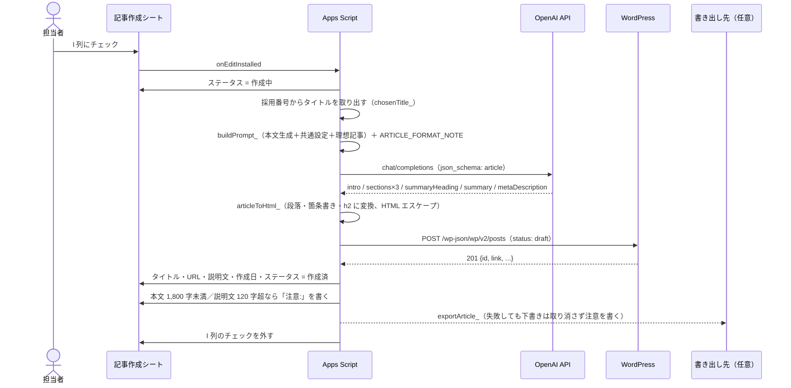

# 技術ドキュメント（開発者向け引き継ぎ）

ブログ記事 下書き自動作成システムの、API 仕様・データ設計・外部サービスとの連携をまとめる。お客様向けの資料は `docs/client/`、セットアップ手順は `docs/setup.md`、テストの経過は `docs/test-report.md` を参照。

最終更新: 2026-11-14

## 1. 全体構成



| 要素 | 役割 | 認証 |
|---|---|---|
| Google スプレッドシート | 入力画面・データの保存先（DB の代わり） | Google アカウントの共有 |
| Google Apps Script | 処理の本体。スプレッドシートに紐づく（コンテナバインド）スクリプト | 実行者の Google アカウント |
| OpenAI API | タイトル案・記事本文の生成（Chat Completions、JSON スキーマ指定） | API キー（Bearer） |
| WordPress REST API | 記事を下書きとして保存 | アプリケーションパスワード（Basic）。寄稿者権限の専用ユーザー |
| スクリプトプロパティ | API キー・接続先・モード切り替えの保存 | Apps Script の編集者だけが見られる |

ウェブアプリとしてのデプロイは不要（外から呼ばれる入口が無いため）。コードは Apps Script のエディタで保存すれば即時反映される。

## 2. ファイル構成と責務

Apps Script は全ファイルが 1 つのグローバル空間に読み込まれる。`_` で終わる関数は内部関数（エディタの実行メニューに出ない）。

| ファイル | 責務 | 主な関数 |
|---|---|---|
| `gas/Config.js` | 定数（シート名・列定義・色・状態・API の URL・モデル名） | `articleCol_(key)` |
| `gas/Code.js` | 編集イベントの受け口と振り分け、排他制御 | `onEditInstalled(e)`、`handleArticleEdit_`、`handleSettingEdit_`、`fillPublishedAt_`、`withLock_` |
| `gas/Settings.js` | 共通設定・個別設定の読み込み、「反映」、指示文の組み立て | `applySettings_`、`getSettings_`、`buildPrompt_` |
| `gas/OpenAi.js` | OpenAI API の呼び出しとエラーの日本語化 | `requestOpenAiJson_`、`isOpenAiMock_` |
| `gas/Titles.js` | タイトル 5 案の生成 | `generateTitlesForRow_` |
| `gas/Body.js` | 本文の生成・HTML 変換・WordPress 保存・シートへの結果の書き込み | `generateBodyForRow_`、`articleToHtml_`、`articleBodyLength_` |
| `gas/WordPress.js` | WordPress REST API への下書き保存 | `postDraftToWordPress_`、`buildWpDraftRequest_`、`parseWpDraftResponse_` |
| `gas/TestOutput.js` | 生成した記事を確認用のスプレッドシートへ書き出す（任意） | `exportArticle_`、`articleToText_` |
| `gas/Setup.js` | 初回のシート作成・トリガー登録・設定の初期値 | `setupSheets()`、`setupTriggers()` |
| `test/mock-wordpress.js` | 仮の WordPress（Node.js）。投稿作成 API だけを本物と同じ形で返す | `createMockWordPress()` |
| `test/send-draft-test.js` | `gas/WordPress.js` の関数で作ったリクエストを仮の WordPress に送るテスト | ― |

`buildWpDraftRequest_` / `parseWpDraftResponse_` / `articleToHtml_` は Apps Script の機能に依存しないので、Node.js のテストからそのまま読み込める。

## 3. データ設計（スプレッドシート）

### 3-1. 「記事作成」シート（1 行 = 1 記事）

列の並びは `ARTICLE_COLUMNS`（`gas/Config.js`）が正。列を足すときはここに追加する（途中に挿入すると既存シートと列がずれるので、既存運用中は末尾に足す）。

| 列 | key | 見出し | 型 | 書く人 | 入力規則・備考 |
|---|---|---|---|---|---|
| A | `createdAt` | 作成日 | 日付 | 自動 | 下書き保存に成功した日時 |
| B | `publishedAt` | 公開日 | 日付 | 自動 | ステータスを「公開済」にしたとき、空なら入れる |
| C | `keyword` | キーワード | 文字列 | 担当者 | 必須 |
| D | `subKeyword` | サブキーワード | 文字列 | 担当者 | 任意 |
| E | `memo` | 補足メモ（任意） | 文字列 | 担当者 | 任意 |
| F | `makeTitles` | タイトル5案を作成 | チェックボックス | 担当者 | TRUE でタイトル生成。処理後に FALSE に戻す |
| G | `titleIdeas` | タイトル案 | 文字列（複数行） | 自動 | `1. 〜\n2. 〜` の形で 5 行 |
| H | `chosenIdea` | 採用する案（1〜5） | 数値 | 担当者 | 1〜5 のリスト |
| I | `makeBody` | 本文を作成 | チェックボックス | 担当者 | TRUE で本文生成と保存。処理後に FALSE に戻す |
| J | `status` | ステータス | 文字列 | 自動（公開済だけ手） | 下の状態のリスト |
| K | `title` | タイトル | 文字列 | 自動 | 下書きにしたタイトル |
| L | `url` | WordPress URL | 文字列 | 自動 | 下書きの編集画面の URL |
| M | `error` | エラー内容 | 文字列 | 自動 | 失敗の理由、または「注意:」で始まる注意 |
| N | `metaDescription` | 説明文（120 字以内） | 文字列 | 自動 | 見出しが無ければ初回の本文作成時に自動で付く |

- 用意する行数は `ARTICLE_ROWS`（100 行）。足りなくなったら、チェックボックスと入力規則を下の行にコピーする
- 自動の列（灰色）は警告だけの保護（`setWarningOnly(true)`）。スクリプトからの書き込みは妨げない

### 3-2. ステータスの遷移



- 「作成済」「公開済」の行は、タイトル・本文とも作り直さない（二重投稿の防止）
- 処理が途中で止まる（実行時間の上限など）と「作成中」のまま残る。手で「タイトル案あり」に戻せば再実行できる

### 3-3. 「共通設定」シート

| 行 | A 列（項目） | B 列 | 使われ方 |
|---|---|---|---|
| 1 | 見出し | | |
| 2〜8 | 文字数／構成／読者／トーン／使わない表現／独自性のルール／理想記事（手本） | 内容 | `{共通設定}` に「- 項目: 内容」の形で入る。**理想記事だけは** `{理想記事}` として本文の指示文にだけ入る |
| 9 | （空行） | | 設定の表の終わりの目印。A 列が空の行で読み込みを止める |
| 10 | 反映する（チェックを入れる） | チェックボックス | TRUE で「反映」 |
| 11 | 最後に反映した日時 | 日時 | 自動 |

項目は追加してよい（2〜8 行目の下、空行の前に行を挿入する）。追加した項目は自動で `{共通設定}` に入る。

### 3-4. 「個別設定」シート

| 行 | A 列 | B 列 |
|---|---|---|
| 2 | タイトル生成 | タイトル用の指示文 |
| 3 | 本文生成 | 本文用の指示文 |
| 5 | 反映する（チェックを入れる） | チェックボックス |
| 6 | 最後に反映した日時 | 日時 |

A 列の文字（`PROMPT_KEYS`）で指示文を探すので、変えないこと。

### 3-5. 「反映済みの設定」シート（非表示）

「反映」を押した時点の設定の控え。作成時はこのシートを優先して読み、まだ反映していないシートは今の内容を使う（`getSettings_`）。書きかけの設定が途中で使われないようにするため。

| 列 | 内容 |
|---|---|
| A | 元のシート名（共通設定／個別設定） |
| B | 項目名 |
| C | 値 |

「反映」のたびに、そのシートの分だけを入れ替える。直接編集しない。

### 3-6. 「テスト出力」シート（書き出し先のスプレッドシート・任意）

`TEST_OUTPUT_SHEET_URL` を設定したときだけ、本文の作成に成功するたびに 1 行追加する。

| 列 | 内容 |
|---|---|
| A | 実行日時 |
| B | モデル名（テスト用の文なら「テスト用（OPENAI_MOCK）」） |
| C・D | キーワード・タイトル |
| E・F | 説明文・その字数（120 字超は赤字） |
| G | 本文の字数（見出しと空白を除く） |
| H | 本文（見出しに `## ` を付けたテキスト） |
| I | 本文（WordPress に送った HTML） |
| J | WordPress URL |

### 3-7. スクリプトプロパティ

| 名前 | 必須 | 内容 |
|---|---|---|
| `OPENAI_API_KEY` | 本番で必須 | OpenAI の API キー |
| `OPENAI_MODEL` | 任意 | モデル名。省略時は `DEFAULT_OPENAI_MODEL`（`gpt-6.1-sol`） |
| `WP_BASE_URL` | 本番で必須 | サイトの URL（末尾の `/` は自動で除く） |
| `WP_USERNAME` | 本番で必須 | 専用ユーザーのユーザー名 |
| `WP_APP_PASSWORD` | 本番で必須 | アプリケーションパスワード（空白込みでよい） |
| `OPENAI_MOCK` | 開発用 | `true` で OpenAI を呼ばず、テスト用の文を返す |
| `WP_MOCK` | 開発用 | `true` で WordPress に送らず、保存できたことにする（URL は `https://example.com/...`） |
| `TEST_OUTPUT_SHEET_URL` | 任意 | 記事の書き出し先のスプレッドシートの URL |

## 4. 処理の流れ

### 4-1. 入口とトリガー

- `setupTriggers()` が **インストール型の編集トリガー**（`onEditInstalled`）を登録する。外部 API を呼ぶため、シンプルトリガーの `onEdit` は使わない（シンプルトリガーは外部通信ができない。`onEdit` という名前にすると両方で二重に動く）
- `onEditInstalled(e)` は `e.range` のシート名と列で振り分ける。複数行への貼り付けにも対応（範囲の各行を見る）

| 編集されたもの | 呼ぶ処理 |
|---|---|
| 記事作成の F 列が TRUE | `generateTitlesForRow_` |
| 記事作成の I 列が TRUE | `generateBodyForRow_` |
| 記事作成の J 列（ステータス） | `fillPublishedAt_` |
| 共通設定・個別設定の B 列で、A 列が「反映する（チェックを入れる）」の行が TRUE | `applySettings_` |

- 処理はすべて `withLock_`（`LockService.getDocumentLock()`、最大 5 分待ち）の中で行い、同時に押されても 1 件ずつ順番に実行する
- スクリプトがセルを書き換えても編集トリガーは発火しないので、チェックを FALSE に戻す処理がループすることはない

### 4-2. タイトル 5 案



5 案に満たなければエラー。6 案以上なら先頭の 5 案を使う。

### 4-3. 本文の作成と下書き保存



WordPress への保存に失敗した場合はステータスを「エラー」にする。生成した記事は保存しないので、再実行すると記事を作り直す（OpenAI の費用がもう一度かかる）。

## 5. 外部 API の仕様

### 5-1. OpenAI API（`gas/OpenAi.js`）

**リクエスト**

```
POST https://api.openai.com/v1/chat/completions
Authorization: Bearer {OPENAI_API_KEY}
Content-Type: application/json
```

```json
{
  "model": "gpt-6.1-sol",
  "messages": [{ "role": "user", "content": "（組み立てた指示文）" }],
  "response_format": {
    "type": "json_schema",
    "json_schema": { "name": "article", "strict": true, "schema": { } }
  }
}
```

**返事の形（JSON スキーマ）**

| 用途 | スキーマ名 | 形 |
|---|---|---|
| タイトル | `title_ideas` | `{ "titles": string[] }` |
| 本文 | `article` | `{ "intro": string, "sections": [{ "heading": string, "body": string }], "summaryHeading": string, "summary": string, "metaDescription": string }` |

- `choices[0].message.content` を JSON として読む。`message.refusal` があればエラー
- 見出しの数が `SECTION_COUNT`（3）でなければエラー（形の崩れ。再実行で直ることが多い）
- `temperature` などの生成パラメータは指定していない（モデルの既定値）

**エラーの扱い**

| HTTP | シートに書く文言 |
|---|---|
| 401 | OpenAI の API キーが正しくありません |
| 429 | OpenAI の利用上限に達したか、短時間に送りすぎました…（残高不足もここ） |
| 500 番台 | OpenAI 側で一時的な障害が起きています… |
| その他 | OpenAI への依頼に失敗しました（コード）。モデル名などの設定を確認してください |

応答本文の先頭 300 文字を `console.error('[OpenAI] status …')` に残す（記事の中身は console に出さない）。

### 5-2. WordPress REST API（`gas/WordPress.js`）

**リクエスト**

```
POST {WP_BASE_URL}/wp-json/wp/v2/posts
Authorization: Basic base64({WP_USERNAME}:{WP_APP_PASSWORD})
Content-Type: application/json
```

```json
{
  "title": "採用したタイトル",
  "content": "<p>導入</p>\n<h2>見出し</h2>\n<p>本文</p>\n…\n<h2>まとめ：…</h2>\n<p>…</p>",
  "excerpt": "説明文（メタディスクリプション）",
  "status": "draft"
}
```

- `status` は常に `draft`（自動では公開しない）
- `excerpt` は WordPress の「抜粋」。SEO プラグインの説明文の欄には入らないので、必要ならシートの説明文を担当者が貼る

**レスポンス**

| HTTP | 処理 |
|---|---|
| 201（または 200） | `id` を読み、編集画面の URL `{WP_BASE_URL}/wp-admin/post.php?post={id}&action=edit` をシートに書く |
| 401 | ユーザー名かアプリケーションパスワードが違います |
| 403 | 専用ユーザーに記事を作る権限が無いか、セキュリティプラグインに止められました |
| 404 | WP_BASE_URL が違うか、REST API が使えない設定になっています |
| 500 番台 | WordPress のサーバーで一時的なエラーが起きています |
| 通信そのものの失敗 | WordPress に接続できませんでした（URL の確認を促す） |

エラーの JSON に `code`（例: `incorrect_password`、`rest_cannot_create`）があれば、文言の後ろの括弧に付ける。セキュリティプラグインが HTML を返す場合も、ステータスコードで判定する。

**専用ユーザーの権限**: 寄稿者。下書きの作成（`edit_posts`）はできるが、公開・他の記事の編集・設定変更はできない。管理者のアプリケーションパスワードでも動くが、使わない（理由は `docs/client/api-setup.html` の 2-1）。

## 6. 指示文（プロンプト）の組み立て

`buildPrompt_(promptKey, values)` が次の順で作る。

1. 「個別設定」の指示文（反映済みの控えを優先）
2. `{ }` の差し込みを置き換える

| 差し込み | 中身 |
|---|---|
| `{キーワード}` `{サブキーワード}` `{補足メモ}` | 記事作成シートの行の値（空なら「（なし）」） |
| `{タイトル}` | 採用したタイトル（本文のみ） |
| `{共通設定}` | 共通設定の全項目（理想記事を除く）を「- 項目: 内容」で並べたもの |
| `{理想記事}` | 共通設定の「理想記事（手本）」 |

3. 本文の場合は、末尾に `ARTICLE_FORMAT_NOTE`（`gas/Body.js`）を足す。内容は、長さの目安・手本は文体だけまねる・作り話をしない・タイトルの約束を守る・繰り返さない、の 5 つのルールと、返事の形式。**品質テストで見つけた問題への対策** なので、消す場合は `docs/test-report.md` を確認すること

知らない差し込みは置き換えずに残す。

## 7. ログとエラー処理の方針

- 失敗はすべてシートの「エラー内容」に日本語で書き、ステータスを「エラー」にする。担当者が文言で `docs/client/troubleshooting.html` を引けるよう、**文言を変えたら資料も直す**
- 下書きの保存後に分かった問題（字数・書き出しの失敗）は、エラーにせず「注意:」で知らせる
- `console.error('[機能名] …')` の形で残す（Apps Script の「実行数」で見られる）。記事の本文や API キーは console に出さない
- 例外は `finally` でチェックボックスを必ず FALSE に戻す

## 8. テスト

| テスト | 方法 | 確認すること |
|---|---|---|
| WordPress への送信 | `node test/send-draft-test.js` | 正常 201 と、401・403（権限／プラグイン）・404・500 の文言。届いた中身が draft・見出し 4 つ・抜粋あり |
| シート上の流れ（API なし） | スクリプトプロパティ `OPENAI_MOCK`・`WP_MOCK` を `true` | チェック → 状態の変化 → 結果の書き込み |
| 記事の品質 | `OPENAI_MOCK` を外し、`TEST_OUTPUT_SHEET_URL` を設定して本文を作る | 書き出し先で本文・説明文・字数を読む（結果は `docs/test-report.md`） |

## 9. 制約・注意点

| 項目 | 内容 |
|---|---|
| 実行時間 | Apps Script の 1 回の実行には時間の上限がある。本文の作成は 1〜2 分。1 回 1 記事に限定している |
| 通信時間 | `UrlFetchApp` にも上限がある。記事を長くしすぎる（例: 5,000 字以上）と時間切れのおそれ |
| 同時実行 | ドキュメントロックで直列化。5 分待っても取れなければトーストでエラー |
| 費用 | gpt-6.1-sol で 1 本 約 7 円の試算（2026-11 の料金表）。モデルを変えると変わる |
| 二重投稿 | 「作成済」「公開済」は作り直さない。WordPress 側の保存に成功したのにシートへの書き込み前に止まった場合は、下書きが残っている可能性がある（再実行前に WordPress の下書き一覧を確認） |
| 列の変更 | `ARTICLE_COLUMNS` の途中に列を入れると、運用中のシートと位置がずれる。追加は末尾に |
| コードの反映 | エディタで保存すれば即反映（デプロイ不要）。ファイルを貼り直すときは、全選択してから貼る |

## 10. 今後の拡張の候補

- 毎朝の自動実行（時間主導トリガーで「未作成」の行を 1 件ずつ処理）
- スプレッドシートのメニューから操作する形（一度作って、操作の入口が 2 つになり分かりにくいため外した）
- SEO プラグイン（Yoast など）の説明文の欄への書き込み（プラグインごとの REST の項目に対応が必要）
- WordPress のカテゴリ・タグの自動設定
- 「作成済」の判定を WordPress 側の公開状態と同期し、公開日を自動で取る
