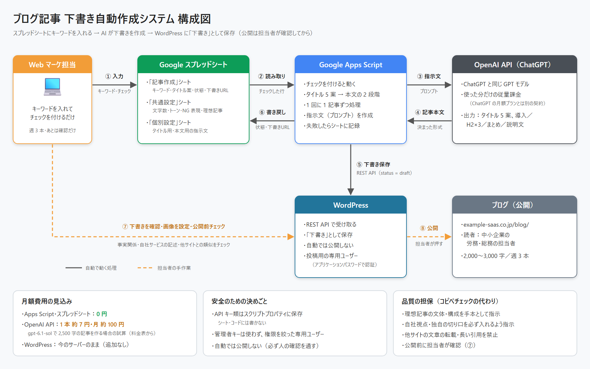

# ブログ記事 下書き自動作成 提案書

## 1. 現状の課題
- SEO 対策のブログを **週 3 本**、ネタ出しから執筆まで **1 本 3 時間** → **週 9 時間（月 約 39 時間）** を記事作成に使っている
- キーワードはスプレッドシートで管理しているが、そこから記事にする作業はすべて手作業

## 2. 提案する解決策
スプレッドシートにキーワードを入れると、AI が記事の下書きを作り、WordPress に **「下書き」として保存** する仕組みを作ります。担当者様は中身を確認して公開ボタンを押すだけになります。

**やること**:
- キーワードから下書きを自動作成（タイトル → 導入 → 見出し 3 つ → まとめ、2,000〜3,000 字）
- 理想記事を手本に「カジュアルだけど専門的」な書きぶりに調整
- WordPress への下書き保存と、シートへの結果（下書きのリンク・状態）の書き込み
- 文字数・トーン・使わない表現を、シートから変えられる設定欄
- 操作マニュアル（キーワードの入れ方・確認から公開までの手順）

**やらないこと**:
- **自動公開**（AI の誤りがそのまま公開されるのを防ぐため、公開は必ず人が行います）
- 画像の作成・設定（担当者様が設定）
- **コピペチェックの組み込み** → 代わりに、AI への指示で「自社の視点・独自の切り口を入れる」「他サイトの文章を写さない」を徹底し、公開前に担当者様が確認する運用をご提案します
- キーワード選定・検索順位の分析、公開済み記事の書き直し

## 3. 想定効果
| | 今 | 導入後（見込み） |
|---|---|---|
| 1 本あたりの作業 | 3 時間（ネタ出し・執筆） | **1 時間以内**（確認・手直し・画像設定） |
| 週の作業時間 | 9 時間 | **3 時間以内**（週 6 時間・月 約 26 時間の削減） |
| 担当者様の作業 | 一から書く | キーワードを入れて、できた下書きを確認する |

※ 導入後の時間は、試運転で 3〜5 本作成して実測し、納品時にご報告します。

## 4. AI の下書きの仕上がりについて（事前にご了承ください）
AI が作るのは **60〜70 点の下書き** です。そのまま公開できる 100 点の記事ではなく、**担当者様が手直しして仕上げるためのスタートライン** とお考えください。上の「1 時間以内」は、この手直しを含めた時間です。

| AI が得意なこと（下書きに入る） | 担当者様に足していただくこと |
|---|---|
| 見出しの構成、一般的な説明、読みやすい文章 | 自社サービスならではの事例・数字・お客様の声 |
| 決めた文字数・トーンに沿った書きぶり | 事実・数字・最新情報が正しいかの確認 |
| ネタ出しの手間をなくす | 言い回しの最終調整（御社らしさ） |

- 試運転の 3 日間で、理想記事に近づくよう AI への指示を調整します。納品後 1 か月も調整を続けますが、それでも毎回 100 点にはなりません
- 「手直しなしで公開できる記事」が必要な場合は、この仕組みでは実現できません

## 5. 技術構成

- **Google スプレッドシート**: 「記事作成」「共通設定」「個別設定」の 3 シート。キーワードを入れ、チェックボックスでタイトル案・本文を作成。状態（未作成 / タイトル案あり / 作成済 / 公開済）と下書きリンクを一覧で確認
- **Google Apps Script**（Google が無料で提供する自動処理の仕組み）: チェックボックスにチェックを付けると動き、1 本ずつ下書きを作成
- **OpenAI API**（ChatGPT と同じ AI を、プログラムから呼び出す窓口）: 記事の文章を作成
- **WordPress REST API**（外部から記事を保存できる WordPress の標準機能。有効化済み）: 下書きとして保存
- **安全面**: 管理者権限のキーは使わず、記事の保存だけができる専用ユーザーを作って接続します。万一キーが漏れても、サイトの設定は変更されません

## 6. スケジュールと費用
- 開発期間: **2 週間**（準備・接続テスト 2 日 → 開発 1 週間 → 試運転・文章の調整 3 日 → 納品・操作説明）
- 初期費用: **8 万円（税込）**（納品後 1 か月の不具合対応・文章の調整を含む）
- 月額: **100 円前後の見込み**（OpenAI API の利用料のみ。使った分だけのお支払い）
  - 試作で 2,500 字前後の記事を作ったモデル（gpt-6.1-sol）の料金表から試算: **1 本 約 7 円、月 13 本で 約 100 円**（タイトル案の作成は 1 回 0.1 円未満）
  - より安いモデル（gpt-4.1-mini、1 本 約 1 円）も試しましたが、字数が半分ほどにとどまり、指示を守りきれなかったため採用しません
  - Apps Script・スプレッドシート・WordPress の追加費用は **0 円**
  - ChatGPT の月額プランとは別契約です。クレジットは前払い（最低 5 ドル）で、自動チャージはオフにしておけば使いすぎを防げます
  - 料金は OpenAI の改定で変わることがあるため、契約前に最新の料金表で確認します

## 7. ご準備いただくもの
1. OpenAI API の利用登録（御社名義・お支払いは御社のカード）※ 登録手順はご案内します
2. WordPress に記事保存用の専用ユーザーを 1 つ作成 ※ 手順書をお渡しします
3. キーワード管理シートへの共有（編集権限）
